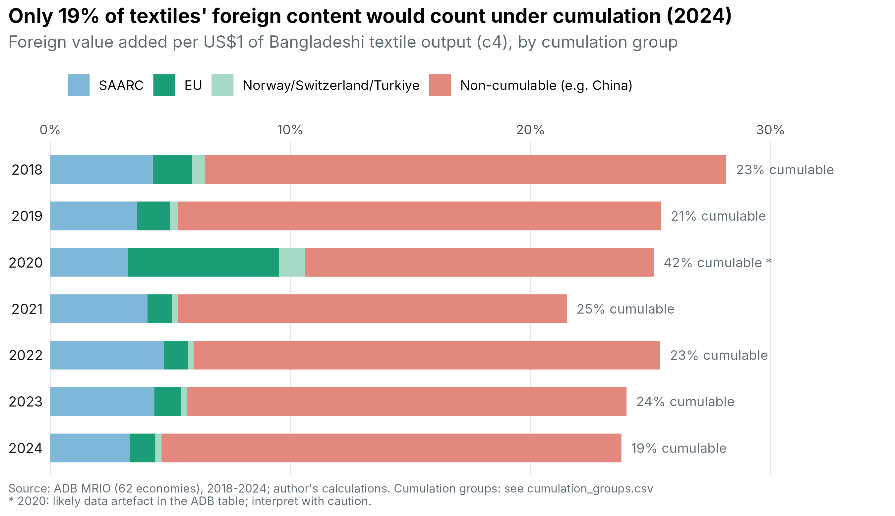
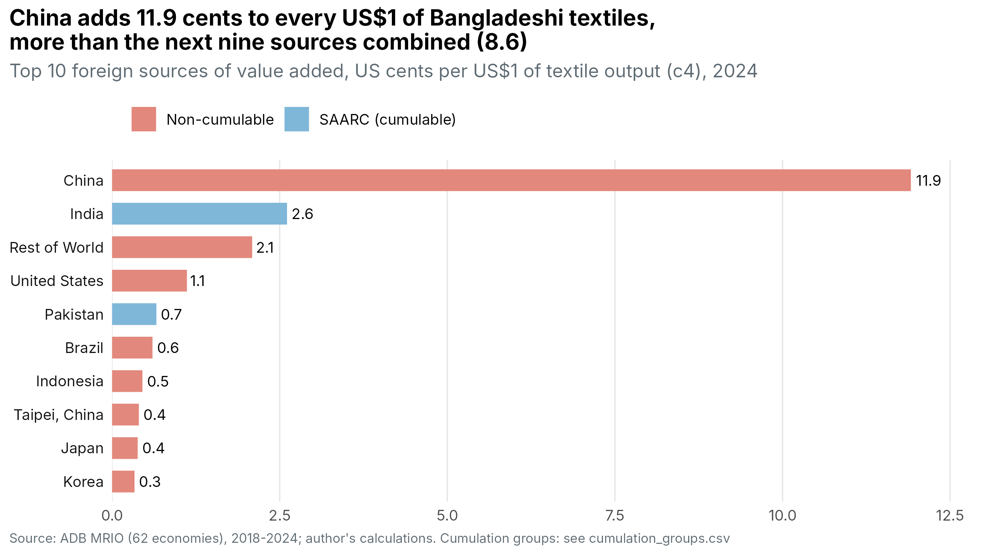
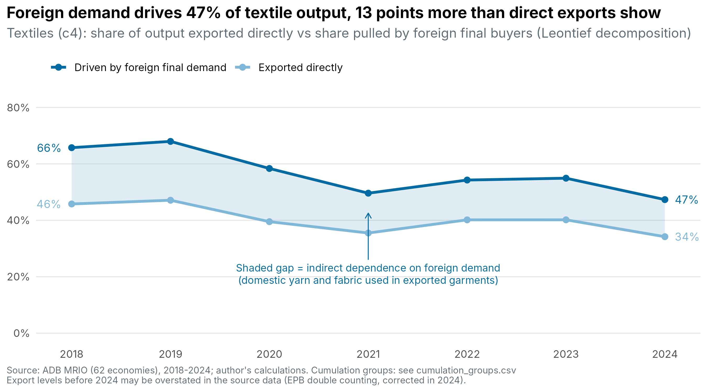

# Rules of Origin, Value Added and Bangladesh's Apparel Exports after LDC Graduation

Bangladesh is due to graduate from Least Developed Country (LDC) status in November 2029. After graduation, its garment exports to the EU face stricter rules of origin. This project asks how much of the value in Bangladeshi textiles and apparel would still count as "originating" under those rules.

**Module 1** (this repository) traces where the value in Bangladeshi textiles comes from, using the ADB multi-regional input–output (MRIO) tables for 2018–2024. It groups foreign suppliers by whether Bangladesh could *cumulate* their inputs under EU rules.

## Key findings (2024, textiles, ADB sector c4)

- About **76 cents** of every US$1 of textile output is domestic value added. About **24 cents** is foreign.
- Only about **19%** of that foreign content comes from cumulable partners (SAARC, the EU, and Norway/Switzerland/Türkiye).
- **China adds 11.9 cents** per US$1, more than the next nine foreign sources combined, and is outside every cumulation group.
- **Foreign final demand drives 47%** of textile output, 13 points more than the 34% exported directly. The difference is domestic yarn and fabric used in exported garments.

## Method

| Step | Formula |
|---|---|
| Input coefficients | A = Z · diag(x)⁻¹ |
| Value-added coefficients | v = 1 − colSums(A) |
| Leontief inverse (global, 2205 × 2205) | L = (I − A)⁻¹ |
| Value-added origin of sector j | v · L[, j], summed by country and cumulation group |
| Output driven by final buyer g | x_j = Σ_k L[j, k] · Y[k, g] |

2205 = 63 economies × 35 sectors. **2020 is excluded from trend comparisons**, because the ADB table shows a one-year jump in EU content that reverses in 2021 (a likely data artefact).

## Files

| File | What it does |
|---|---|
| `01_mrio_va_origin.R` | Reads the ADB MRIO tables, builds the Leontief inverse, writes all `m1_*.csv` results |
| `00_chart_setup.R` | Shared chart style, colours and save function |
| `01_chart_foreign_content_by_group.R` | Chart: foreign content by cumulation group, 2018–2024 |
| `02_chart_export_vs_foreign_driven.R` | Chart: direct exports vs output driven by foreign demand |
| `03_chart_top_foreign_sources.R` | Chart: top 10 foreign sources of value added |
| `m1_*.csv` | Results tables |
| `*.png` | Charts |

## How to run

1. Download the ADB MRIO 62-economy tables (2018–2024) from the [ADB MRIO database](https://kidb.adb.org/globalization).
2. In `01_mrio_va_origin.R`, set `root` to your project folder and run it. The results go to `output/tables`.
3. Check `cumulation_groups.csv`, which the script writes on its first run, against the current EU GSP rules.
4. Run the chart scripts (`00_chart_setup.R` must be in the same folder as them, and its paths must match yours).

Packages: `data.table`, `readxl`, `ggplot2`.

## Next steps

- **Module 2:** product-level data (CEPII BACI, HS6) to compare knit (Ch. 61) and woven (Ch. 62) garments against the rules of origin.
- **Module 3:** structural gravity model (PPML, `fixest`) to estimate the trade effects of the post-graduation scenarios.

## Data and disclaimer

Data: Asian Development Bank, Multi-Regional Input–Output Tables. Calculations are the author's own.

*Views are the author's own and do not represent the Government of Bangladesh.*

**Author:** Elish Sharmin
